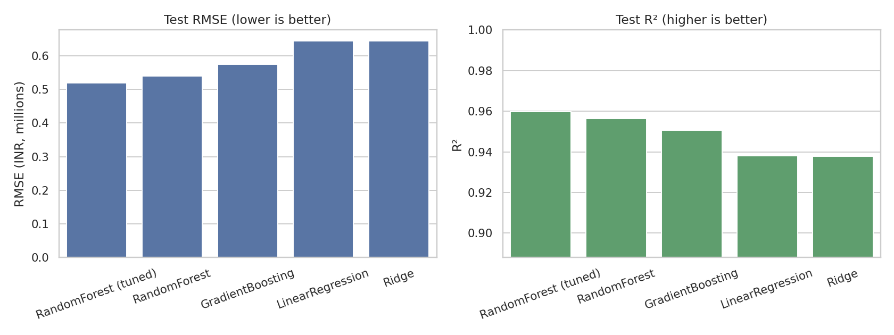
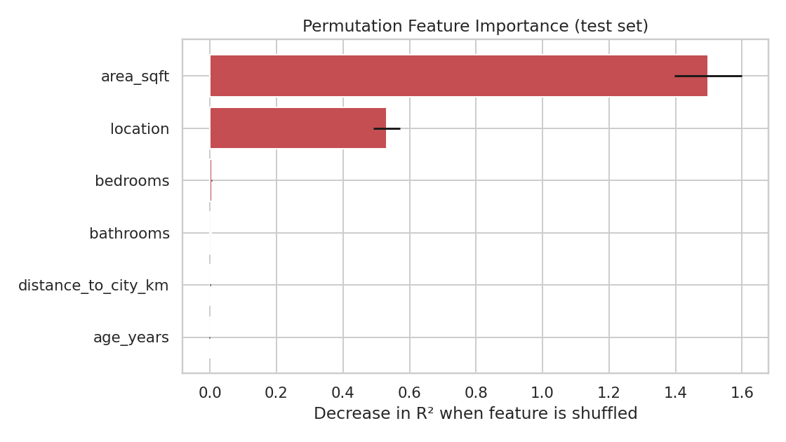
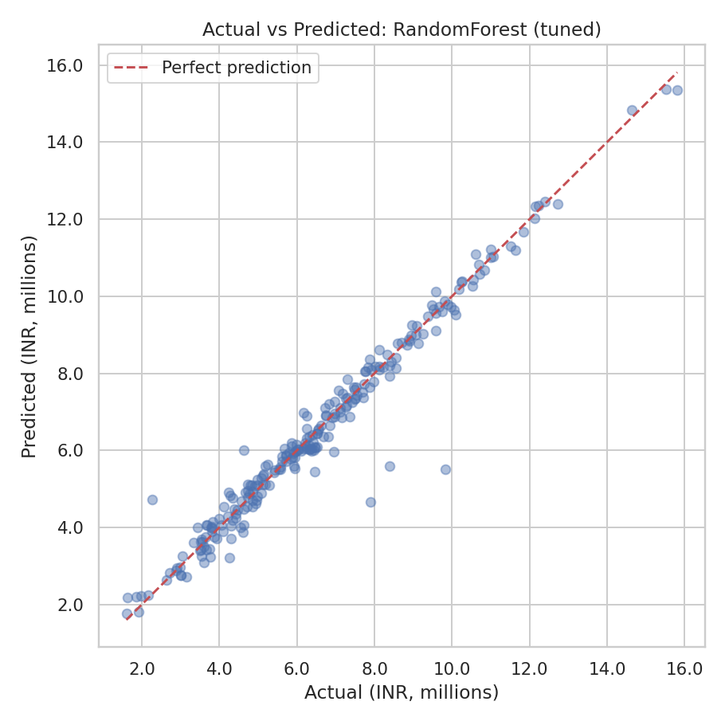
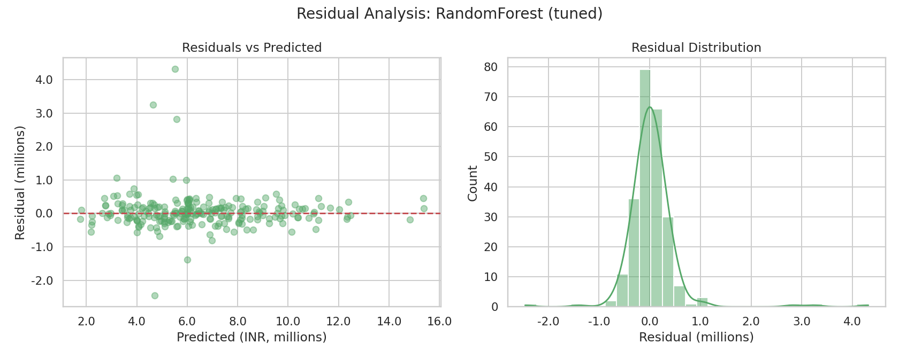
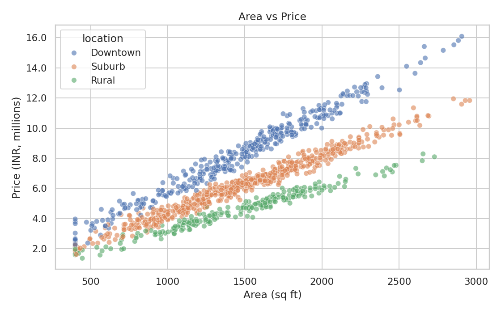

# 🏠 House Price Prediction

**[Live demo](https://house-price-prediction-h5mxjmd69hknbztdq79nyk.streamlit.app)**

[](https://github.com/pooja-jharani/house-price-prediction/actions)


An end-to-end regression project: data generation and validation → EDA → leakage-safe preprocessing → cross-validated model comparison → hyper-parameter tuning → evaluation and explainability → a CLI and an interactive demo app.
**[🚀 Live demo](https://house-price-prediction-h5mxjmd69hknbztdq79nyk.streamlit.app)**

**Headline result:** a tuned Random Forest reaches **R² = 0.960**, **MAE ≈ ₹276k**, **MAPE ≈ 5.1%** on a held-out test set.

> ⚠️ **The dataset is synthetic** (generated by `data.py` with a known pricing formula), so these numbers show that the pipeline works, not how accurate the model would be on real listings. See [Limitations](#limitations).

## Highlights

- **Reproducible**: seeded data generation, fixed splits, one command per stage.
- **No data leakage**: imputation, scaling and encoding live inside the `sklearn` pipeline, so they are fit on training folds only.
- **Honest model selection**: candidates are compared with 5-fold CV on the training set; the test set is used once, for final reporting.
- **Explainable**: permutation importance, residual diagnostics, actual-vs-predicted plots.
- **Production habits**: `src/` layout, typed/validated inference inputs, CLI, saved model metadata, unit tests, linting config, CI.

## Quick start

```bash
git clone https://github.com/pooja-jharani/house-price-prediction.git
cd house-price-prediction
python -m venv .venv && source .venv/bin/activate
pip install -e ".[dev,app]"

house-price generate-data        # writes data/raw/houses.csv
house-price train --tune         # trains, evaluates, saves model + figures + metrics
house-price predict --area 1800 --bedrooms 3 --bathrooms 2 --age 5 --distance 4.5 --location Suburb
streamlit run app/streamlit_app.py   # optional interactive demo
```

`make data`, `make train`, `make tune`, `make test`, `make lint` and `make app` are shortcuts for the same commands.

## Project structure

```
house-price-prediction/
├── src/house_price/
│   ├── config.py        # paths, feature lists, constants
│   ├── data.py          # synthetic data generation, loading, schema validation
│   ├── features.py      # preprocessing ColumnTransformer
│   ├── models.py        # candidate models + tuning search spaces
│   ├── train.py         # CV, selection, tuning, evaluation, artifact saving
│   ├── evaluate.py      # RMSE / MAE / MAPE / R²
│   ├── visualize.py     # EDA and diagnostic plots
│   ├── predict.py       # validated single-house inference
│   └── cli.py           # `house-price` command
├── app/streamlit_app.py # interactive demo
├── tests/               # pytest suite (data, features, training, inference, CLI)
├── data/raw/houses.csv  # generated dataset
├── models/              # best_model.joblib (git-ignored) + metadata.json
├── reports/             # model_comparison.csv + figures/
├── docs/MODEL_CARD.md
├── pyproject.toml  Makefile  requirements.txt  LICENSE
└── .github/workflows/ci.yml
```

## Approach

| Stage | What happens |
|---|---|
| **Data** | 1,200 synthetic houses: area, bedrooms, bathrooms, age, distance to centre, location (Downtown / Suburb / Rural). ~3% of values in three columns are blanked to exercise cleaning. Schema and target are validated on load. |
| **Preprocessing** | Numeric: median imputation + standard scaling. Categorical: mode imputation + one-hot (unknown categories ignored at inference). |
| **Models** | Linear Regression, Ridge, Random Forest, Histogram Gradient Boosting. |
| **Selection** | 5-fold CV on the 80% training split; lowest CV RMSE wins. `--tune` runs a 15-iteration randomized search on the winner and keeps it only if it beats the untuned CV score. |
| **Evaluation** | One pass on the 20% held-out test set: RMSE, MAE, MAPE, R². |

## Results

Test set = 240 houses. Prices in INR.

| Model | CV RMSE | Test RMSE | Test MAE | Test MAPE | Test R² |
|---|---:|---:|---:|---:|---:|
| Linear Regression | 527,518 | 644,079 | 413,492 | 7.8% | 0.938 |
| Ridge | 527,535 | 644,431 | 413,426 | 7.8% | 0.938 |
| Gradient Boosting | 449,042 | 574,891 | 309,781 | 5.3% | 0.951 |
| Random Forest | 444,593 | 539,389 | 272,620 | 5.0% | 0.957 |
| **Random Forest (tuned)** ✅ | **438,407** | **519,215** | **276,067** | **5.1%** | **0.960** |

Full table: [`reports/model_comparison.csv`](reports/model_comparison.csv). Your numbers may differ slightly across library versions.



### What drives the price?

Permutation importance shows **area** and **location** dominate; bedrooms, bathrooms, distance and age contribute little once those two are known. That matches how the synthetic data was built (area × ₹3,800/sq ft, with a Downtown ×1.35 / Rural ×0.75 multiplier).

| | |
|---|---|
|  |  |
|  |  |

More EDA plots (price distribution, correlation heatmap, price by location) are in [`reports/figures/`](reports/figures/).

## Using the model from Python

```python
from house_price.predict import HouseFeatures, predict_price

house = HouseFeatures(area_sqft=1800, bedrooms=3, bathrooms=2,
                      age_years=5, distance_to_city_km=4.5, location="Suburb")
print(f"INR {predict_price(house):,.0f}")
```

Inputs are range-checked, so impossible values (e.g. a 5 sq ft house) raise a clear `ValueError`.

## Testing

```bash
pytest -q       # 22 tests: data, preprocessing, training, inference, CLI
ruff check src tests app
```

## Limitations

- **Synthetic data.** The relationship between features and price is a clean formula plus noise. Real housing data has messy interactions, outliers, time effects and many more predictors, so expect lower accuracy.
- **Small feature set** and no geographic coordinates, condition, amenities or sale date.
- **No uncertainty estimates.** Predictions are point estimates.
- **Not a valuation tool.** See the [model card](docs/MODEL_CARD.md).

## Using real data

Replace `data/raw/houses.csv` with a CSV that has the same columns (`area_sqft, bedrooms, bathrooms, age_years, distance_to_city_km, location, price`) and re-run `house-price train`. For different columns, update `src/house_price/config.py`.

## Roadmap

- [ ] Benchmark on a real dataset (e.g. Kaggle / Ames)
- [ ] Add XGBoost / LightGBM candidates
- [ ] Prediction intervals (quantile regression or conformal prediction)
- [ ] SHAP explanations in the app
- [ ] Containerize and deploy the demo

## License

MIT. See [LICENSE](LICENSE).

